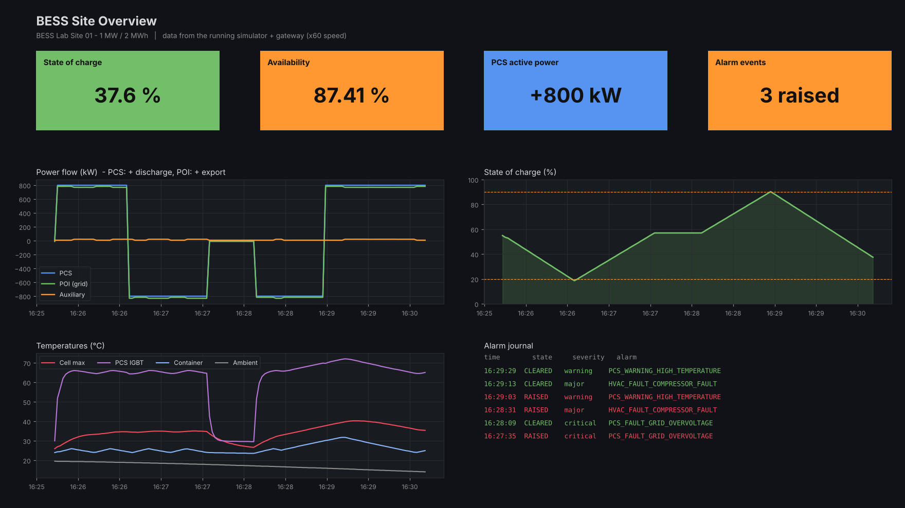

# BESS Site SCADA & Data Acquisition Lab

**Modbus TCP · Linux networking · nftables · WireGuard · InfluxDB · Grafana · Ansible · IEC 62443**

A complete, runnable SCADA lab for a **1 MW / 2 MWh battery energy storage site**: simulated field
devices, a Python SCADA gateway, a time-series historian, operator dashboards, a segmented OT network
with a firewall and VPN, and the commissioning paperwork (FAT/SAT, alarm list, IP plan, baselines,
backup/restore) that a real project delivers.



_Rendered from a real recording of the running simulator and gateway (`tools/render_preview.py`); the Grafana dashboards show the same signals live. A standalone, interactive project page is in [docs/showcase.html](docs/showcase.html) (open it in a browser or publish with GitHub Pages)._


## What it does

| Area | Highlights |
|---|---|
| **Field devices** | PCS, BMS, HVAC and two power meters as Modbus TCP servers (pymodbus), each on its own IP, driven by **one coupled physics model** (SoC with efficiency, LFP voltage curve, cell imbalance, thermal lags, HVAC hysteresis, transformer losses). |
| **Protocol mapping table** | `config/register_map.csv` - 73 points: uint16/int16/uint32/int32/float32, scaling, units, enums, bitfields and **all four 32-bit byte orders** (ABCD, CDAB, BADC, DCBA). Simulator, gateway, FAT runner, CLI and docs are all generated from it. |
| **SCADA gateway** | asyncio poller with **block-read planning** (73 points in 8 requests), comms + heartbeat watchdog, **alarm engine** (46 alarms: deadband, on-delay, bitfields, severities), SoC-window **dispatch** with interlocks and supervised fault reset, InfluxDB writer with **store-and-forward**. |
| **Historian & HMI** | InfluxDB 2.7 with least-privilege tokens (write-only gateway, read-only HMI); two Grafana dashboards **as code**: SoC, power flow, availability %, PCS state timeline, cell voltages/temperatures, live alarm list, alarm journal, bad actors, comms latency. |
| **Network** | 4 zones (field / control / DMZ / uplink) + VPN, IP plan, routing, **nftables default-deny** with 5 explicit conduits, DNAT/SNAT, anti-spoofing, rate-limited drop logging, **WireGuard** with engineer/viewer roles. |
| **Security** | Hardening inspired by **IEC 62443-3-3** (SSH, sysctl, auditd, journald, host firewall, unprivileged read-only containers, secrets handling) - see [docs/iec62443.md](docs/iec62443.md). |
| **Deployment** | **Ansible** roles (common, hardening, docker, stack, wireguard, backup) or `make` + Docker Compose. |
| **Commissioning** | [FAT](docs/FAT_checklist.md) / [SAT](docs/SAT_checklist.md) checklists, **automated FAT runner** (19 tests -> Markdown report), commissioning CLI, backup/restore with checksums, configuration **baseline + drift detection**. |
| **Verification** | 86 pytest tests (codec vectors, alarm logic, end-to-end historian path, FAT) and a **20-check network lab** on plain Linux namespaces proving every conduit and deny rule. |

## Quick start

Requirements: Docker with Compose v2 (Linux, macOS or Windows), `make`, Python 3 for `make init`.

```bash
git clone <this repo> bess-scada-lab && cd bess-scada-lab
make demo                 # flat demo network, works on any Docker host
open http://localhost:3000   # Grafana (anonymous read-only viewer is enabled in demo mode)
```

Full segmented OT network with the firewall and VPN (Linux host, Docker Engine 28+):

```bash
make up                   # field / control / DMZ / uplink networks + fw container
make fat                  # automated FAT -> reports/FAT_report_<date>.md
make cli ARGS="dump bms01"      # commissioning view: raw registers + decoded values
make vpn ENDPOINT=<public-ip>   # WireGuard server + engineer/viewer client configs
```

Without Docker at all:

```bash
pip install -r requirements-dev.txt
make test                 # 86 tests, incl. simulator + gateway + FAT end to end
make local                # simulator + gateway on localhost, prints line protocol
sudo make netlab          # zones, firewall, NAT, spoofing: 20 automated checks with ip netns
```

Deploy onto a fresh Ubuntu host (hardening, Docker, stack, VPN, backups, baseline):

```bash
cd ansible && ansible-galaxy collection install -r requirements.yml && ansible-playbook site.yml
```

The simulator runs 20x faster than real time by default (`SIM_SPEED`), so a full charge/discharge
cycle takes a few minutes - useful for demos.

## Network at a glance

| Zone | VLAN | Subnet | Hosts |
|---|---|---|---|
| Field (L0-1) | 10 | 10.10.10.0/24 | PCS .11, BMS .12, HVAC .13, meters .14 (unit 1 POI, unit 2 AUX) |
| Control (L2) | 20 | 10.10.20.0/24 | SCADA gateway .10 |
| OT DMZ (L3.5) | 30 | 10.10.30.0/24 | historian .10, HMI .11 |
| Uplink | 99 | 172.30.0.0/24 | firewall .254 (publishes HMI :3000 and WireGuard :51820) |
| VPN | wg0 | 10.99.0.0/24 | engineer .10, viewer .20 |

Conduits: gateway -> devices Modbus 502 · gateway -> historian 8086 · uplink/VPN -> HMI 3000 ·
engineer VPN -> historian 8086 and SSH to control. Everything else is dropped and logged. Details:
[IP plan](docs/ip_plan.md), [architecture](docs/architecture.md), [firewall policy](network/nftables/fw.nft).

## Repository layout

```
bess_lab/            Python package
  codec.py           register encoding: types, scaling, byte/word order
  regmap.py          protocol mapping table loader, validation, block-read planner
  sim/               Modbus TCP device simulator + physics model
  gateway/           poller, alarm engine, dispatcher, historian sinks
  cli.py, fat.py     commissioning CLI and automated FAT runner
config/              register_map.csv, site.yaml, alarms.yaml   <- the engineering data
network/             rendered nftables policy, WireGuard configs
docker/              images (app, firewall), entrypoints, InfluxDB init (least-privilege tokens)
grafana/             provisioning + generated dashboards
ansible/             site.yml, roles, group_vars (single source of the zone model)
scripts/             backup.sh, restore.sh, baseline.sh, wg-genkeys.sh
lab/                 network-namespace lab + probes + mock historian
tools/               generators: dashboards, firewall policy, register-map / alarm docs
docs/                architecture, IP plan, register map, alarm list, FAT, SAT, IEC 62443,
                     operations runbook, interview guide, topology diagram
tests/               pytest suite
```

## Power BI reporting

`powerbi/` holds a Power BI-ready data model (7 days of 1-minute site data, alarms, daily KPIs) generated by `tools/export_powerbi.py`, DAX measures, a theme and a [build guide](powerbi/POWERBI_GUIDE.md). Grafana is the live operator HMI; Power BI is the management reporting layer.

## Documentation

- [Architecture and design decisions](docs/architecture.md)
- [IP plan and VLANs](docs/ip_plan.md) · [Topology](docs/topology.svg)
- [Register map](docs/register_map.md) · [Alarm list](docs/alarm_list.md)
- [FAT checklist](docs/FAT_checklist.md) · [SAT checklist](docs/SAT_checklist.md)
- [IEC 62443 mapping](docs/iec62443.md) · [Operations runbook](docs/operations.md)
- [Interview guide](docs/interview_guide.md)

## Honest scope

The field devices are simulated (protocol, encoding and behaviour are realistic; the hardware is not).
The security design follows IEC 62443 concepts but the lab is not certified. Production gaps are listed
in [docs/iec62443.md](docs/iec62443.md).
