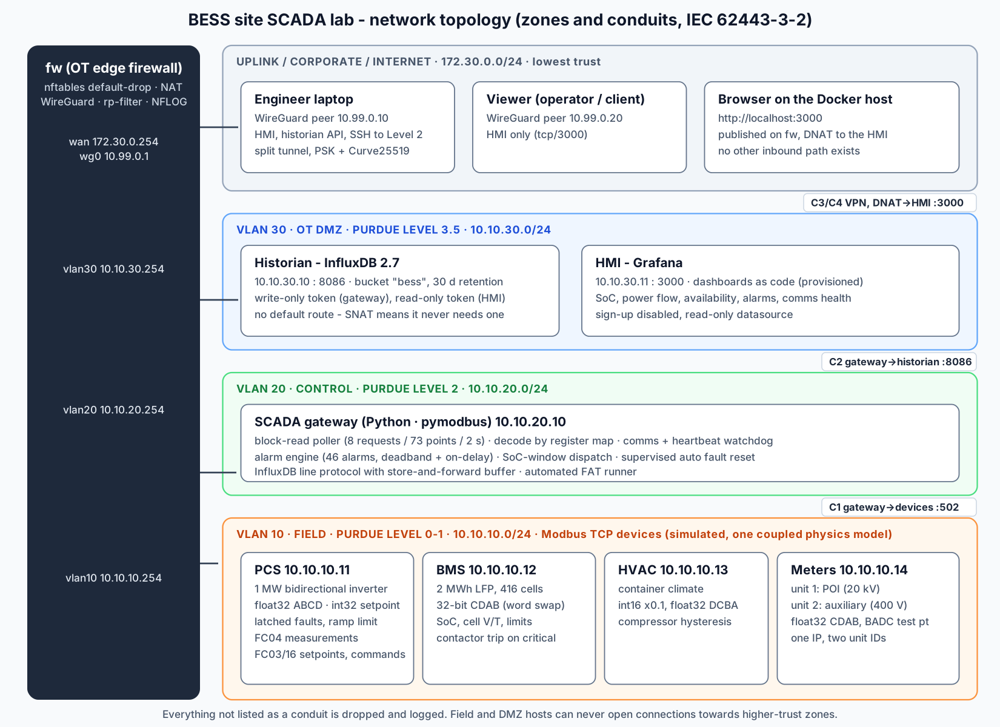

# Architecture



## Components

| Layer | Component | Implementation |
|---|---|---|
| Level 0-1 | PCS, BMS, HVAC, POI + AUX meters | `bess_lab/sim` - pymodbus 3.16 servers, one per IP, register images built from `config/register_map.csv`, driven by one coupled physics model |
| Level 2 | SCADA gateway / site controller | `bess_lab/gateway` - asyncio poller, alarm engine, dispatcher, historian writer |
| Level 3.5 | Historian | InfluxDB 2.7, 30-day retention, least-privilege tokens |
| Level 3.5 | HMI | Grafana, dashboards generated by `tools/build_dashboards.py` and provisioned read-only |
| Boundary | OT edge firewall | Alpine + nftables + WireGuard (`docker/fw*`), policy rendered from the zone model |
| Deployment | Configuration management | Ansible (`ansible/`), Docker Compose, Makefile |

## Data flow (one scan, every 2 s)

```
gateway                                 field devices                historian
   |-- FC04 read input   0..21 -------->  PCS  (1 request, 22 points)
   |-- FC03 read holding 0..7  -------->  PCS  (setpoint readback)
   |-- ... BMS, HVAC, meter unit 1, meter unit 2 (8 requests in total, in parallel per IP)
   |   decode: raw registers -> byte order -> type -> x scale -> engineering value
   |   alarm engine: limits / bits / comms / heartbeat -> RAISED / CLEARED events
   |   dispatcher: SoC window -> FC16 write p_setpoint_kw (int32 ABCD x0.1)
   |-- HTTP POST /api/v2/write (line protocol, ns timestamps) -------------------->  bucket "bess"
                                                                                      | Flux
                                                                                    Grafana
```

Measurements written:

| Measurement | Tags | Fields |
|---|---|---|
| `telemetry` | site, device, profile | every mapped point (float) |
| `comms` | site, device, profile | ok, latency_ms, requests, errors_total |
| `site` | site | available, soc_pct, pcs_power_kw, poi_power_kw, alarms_<severity>, scan_ms |
| `alarm_active` | site, device, alarm_id, severity | active, message, value, since_s (snapshot each scan) |
| `alarm_event` | site, device, alarm_id, severity, state | active, message, value (sequence of events) |

## Design decisions (and the interview answer for each)

**One register map drives everything.** The simulator builds its register images, the gateway builds
its read plan and decoder, the FAT runner and the CLI resolve names, and `docs/register_map.md` is
generated - all from one CSV. A mapping change can never be half-applied.

**Byte order is data, not code.** PCS floats are ABCD, BMS 32-bit values CDAB, the HVAC power float is
DCBA, and the meter has a BADC test point. The FAT cross-checks values that two devices report
independently (PCS DC voltage vs BMS pack voltage) - the practical way to catch a wrong word order
during commissioning, because a swapped float still "looks like a number".

**Block reads with a gap limit.** Points closer than `max_gap` registers are merged into one request
(up to 100 registers). 73 points cost 8 requests per scan. If a device refuses a merged block
(exception 02 on an unmapped gap), the poller falls back to per-point reads for that block.

**Supervision, not just polling.** Comms loss (no response), stale data (heartbeat frozen while the
device still answers) and per-device latency/error counters are first-class signals, stored in the
historian and alarmed.

**Alarms are engineered.** On-delay filters transients, deadband stops chattering, bitfields expand
into one alarm per bit with names from the register map, and per-bit severity overrides exist.
While a device is offline only the comms alarm is evaluated - other alarms hold their state instead
of clearing falsely.

**Closed-loop control with interlocks.** The dispatcher never writes when PCS or BMS data is missing,
respects LOCAL mode, and the PCS clamps the setpoint to BMS limits. Faults latch in the PCS until
reset; the gateway auto-resets at most 3 times per hour and then demands manual intervention.

**Store-and-forward.** If the historian is down the gateway buffers up to 200 000 lines with original
timestamps and back-fills when it returns.

**Default-deny conduits, SNAT into lower-trust zones.** DMZ and field hosts never learn upstream
addresses and need no routes - so even a compromised historian has no route into OT.

**Least privilege for data.** The gateway token can only write the bucket, Grafana's can only read
it; the admin token stays in `.env`/Ansible-generated secrets.

## What is simulated vs real

Real: Modbus TCP protocol and framing, register encoding, polling, alarm logic, historian, dashboards,
routing, nftables, NAT, WireGuard, Ansible, backup/restore. Simulated: the physics of the battery,
inverter, HVAC and grid (a deterministic, coupled model: SoC integration with efficiency, LFP OCV
curve, IR drop, cell imbalance at the SoC extremes, thermal lags, compressor hysteresis, transformer
losses, energy counters).
